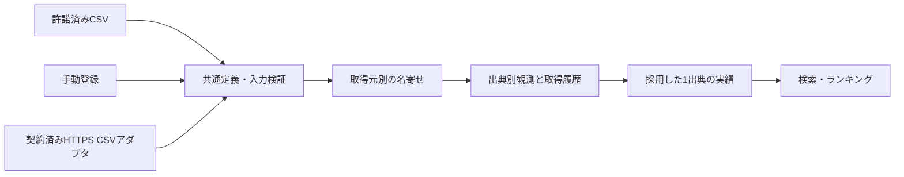

# 複数出典の統合とアダプタ

## 取込の流れ



`source-catalog.ts` は調査候補と分類の一覧で、通信先・契約済みリストではありません。候補を選ぶだけで取得を開始することはありません。

`DataAdapter` は独立した取得処理、許諾検証、取込コンテキストを持ちます。現在は `PermittedCsvAdapter` を提供元・フィードごとに構成します。`runAdapters` は順番に実行し、提供元単位でトランザクションを分け、一方の取得失敗でも他方を処理します。終了コードは1つでも失敗すれば非0です。

正式APIの仕様・利用許諾が得られた場合は、提供元固有の実装を別クラスとして追加し、同じ共通定義のCSVへ変換して取り込めます。実測／推計・ゲーム数の定義や対象台の範囲が不明なときは変換しません。実装が必要な拡張箇所であり、現在API接続が完成しているという意味ではありません。

台番実績・イベント・店舗・設置履歴は既存DBに独立したテーブルを持ちます。今後は日別機種CSVへ無理に詰め込まず、型ごとの検証・出典・訂正処理を持つアダプタを追加します。台別データから機種合計を作る場合は全対象台の網羅と集計定義を確認し、イベントは予定／開催確認／中止を分けます。

## 許諾済みHTTPS CSV

従来の `PERMITTED_CSV_URL` / `PERMITTED_CSV_HOST` だけの設定は自動取得を開始しません。`PERMITTED_SOURCES_FILE` に、下記のJSON配列を保存したローカル設定ファイルのパスを指定します。設定をGitに含めず、秘密情報や契約書本文を入れず、社内で参照できる非秘密の契約識別子を使います。`data/providers.local.json` はGit除外対象です。

```json
[
  {
    "id": "provider-a-daily",
    "providerId": "user",
    "url": "https://data.example.org/daily.csv",
    "allowedHost": "data.example.org",
    "permission": {
      "status": "approved",
      "reference": "REPLACE-WITH-VERIFIED-CONTRACT-REFERENCE",
      "automatedRetrieval": true,
      "redistribution": true,
      "checkedAt": "2026-10-01T00:00:00Z",
      "expiresAt": "2026-12-31T23:59:59Z",
      "minimumIntervalSeconds": 86400
    }
  }
]
```

これは書式の例であり、許諾済み実サービスではありません。実際の契約内容・有効期限・許可された間隔に置き換えてください。現在のアプリは読取り公開型なので、再配布も許可されたデータだけを使用します。公開不可の契約データには別途アプリ全体のアクセス制御が必要です。

```sh
# /workspace/sloanalytics で実行。秘密値はコマンドに埋め込まない。
PERMITTED_SOURCES_FILE=./data/providers.local.json npm run data:update
```

- `providerId`：`user` または候補ID（`min-repo`, `ana-slo`, `slo-map`, `hall-navi`, `slopachi`, `dmm-p-town`, `janbari`, `p-world`）。CSVの `provider_id` と一致必須。
- 許諾が未確認・期限切れ・将来確認日、HTTP、ホスト不一致、認証情報・クエリ・フラグメント・非標準ポート付きURLでは送信しない。
- HTTPS検証は既定のまま。リダイレクトを追わず、30秒・2MBに制限。許可頻度以上の連続実行を拒否する。自動リトライ・cronは登録しない。
- この機能は管理者による許諾確認を機械的な条件にしたもので、契約の真偽を自動検証するものではない。
- 認証が必要な配信APIは未接続。認証キーをURLやクライアントコードに入れず、正式な仕様に応じてサーバー側で別途実装する。

## 名寄せ

管理画面の「出典を照合・登録する」から管理トークンを入力し、「店舗・機種の別名を登録」を開きます。提供元、別名、登録済みの正規店舗・機種、同一と確認した根拠を登録します。

店舗名はNFKC・空白除去・小文字化を基本照合に使います。CSVの `hall_id` は共通の永続IDです。各サイトの独自店舗IDをそのまま流し込まず、事前に対応する共通IDへ変換します。既存店舗の住所・座標の差は別名登録でも許可しません。移転・改称は別途マスタ変更が必要です。

機種は既存略称マスタと提供元固有の別名を照合します。提供元固有の略称は他のサイトへ広げません。未登録の未知名称は従来どおり新機種になります。異なる正式機種を誤統合しないよう、投入前のマスタ確認を推奨します。既存の同じ別名を異なる正規IDに上書きする操作は拒否します。

## 出典・採用・訂正

- `data_sources`：提供元名、公開URL、取得方法、許可根拠、信頼度、集計定義。提供者申告と検証済み事実を混同しない。
- `source_observations`：出典ごとの日別機種実績。取得時刻、取込時刻、公開時刻、提供元更新時刻、元の店舗・機種表記、正規化値を保存。
- `observation_revisions`：取込ごとの完全な観測スナップショット。数値が同じでも取得日時・公開日時の履歴が残る。
- `daily_machine_results`：ランキングに採用した実績を1件だけ保持。新規キーは最初の出典を採用。採用中の同じ出典の訂正は更新。別出典は保管だけで自動上書きしない。
- 管理画面から未採用の出典を比較して「この出典を採用」を実行すると採用先を変更。`data_revisions` と `import_jobs` に記録する。
- 同一の出典・値の再取込では採用実績や合計が増えない。出典名、URL、許諾根拠、定義、取得方法、提供元IDが変わる場合は別出典として保存し、自動的な採用切替を防ぐ。
- 機種ごとの採用台数は観測日にだけ有効。全店合計・将来の設置台数を推定しない。

出典一覧は管理画面で直近100件を表示します。長期間の履歴検索・ページングは今後の拡張です。観測履歴自体はDBに保持し、保存期間の短い契約データには削除運用を実装してから接続してください。

## DB移行と保護

`createDb` が旧バージョン0/1から2へ追加テーブルをトランザクションで作成します。既存実績・デモを削除せず、繰返し起動してもバージョンを巻き戻しません。旧実績の未記録の取得時刻や元表記は捏造して補いません。旧データは従来の出典情報で表示し、新規取込から詳細な観測履歴を残します。本番DBは運用手順に従って先にバックアップしてください。

CSV、手動登録、名寄せ、採用変更は `ADMIN_IMPORT_TOKEN` と同一オリジン検査で保護されます。追加の出典レコード・名寄せ参照APIも管理認証が必要です。トークンはブラウザストレージに保存しません。
